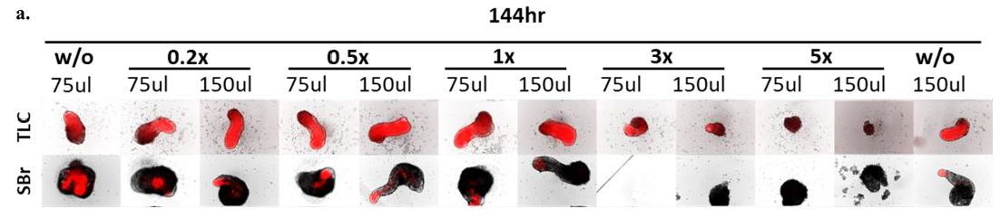
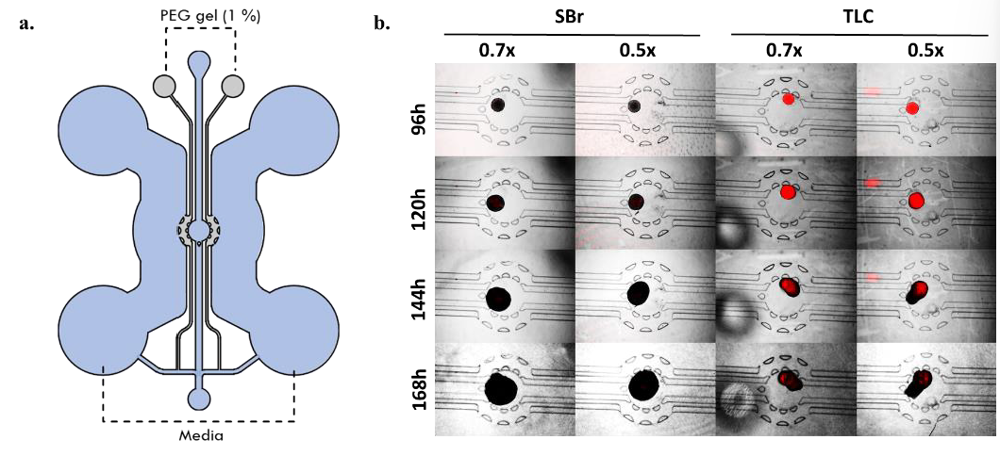

# Digital Twin of Microfluidic Gastruloid Symmetry Breaking & Morphogenesis

This dry-lab modelling project builds a mechanistic in silico framework directly extending experimental microfluidics research conducted in the Laboratory of Stem Cell Bioengineering (LSCB) at EPFL (Study of Gastruloid Self-organization through Spatiotemporal Control of Wnt Activation Using Microfluidics).

## Introduction 

Gastruloids are embryonic organoids formed by aggregated embryonic stem cells with similar morphological change with early stage of embryo development, which makes a good model system for the study of mammalian development and disease. [^1] During the early development stage of the embryo, Wnt signaling coordinates cell polarity, regulates tissue morphogenesis, and plays an important role in the establishment of anteroposterior (AP) axis, which is crucial for embryo development. However, it remains unclear how the elongation axis and extent are regulated, as well as the formation of anterior neural tissue, fore-, mid-, and hindbrain, are still lacking.

<ins>Fig1. Elongation of gastruloid in vitro [^1] </ins>

To guide deterministic AP axis formation via localized chemical gradients, three generations of PDMS microfluidic devices were designed and fabricated, culminating in Chip No. 3—a $1,000\ \mu\text{m}$ diameter, $490\ \mu\text{m}$ high central trapping chamber flanked by $1\%$ PEG hydrogel diffusion barriers, enlarged media reservoirs, and a non-adhesive $2\%$ Pluronic-F127 coating into which gastruloids were transferred at $48\ \text{h}$ after aggregation (AA). Across baseline 96-well perturbation assays and on-chip culture experiments, four empirical observations revealed tight coupling between morphogen transport, device physics, and tissue morphogenesis:

**Narrow Biphasic CHIR99021 Window:** Screening concentrations from 0.2x ($0.474\ \mu\text{M}$) to 5x ($11.85\ \mu\text{M}$) relative to standard 1x ($2.37\ \mu\text{M}$) across $75\ \mu\text{L}$ and $150\ \mu\text{L}$ well volumes, alongside $18\text{–}48\ \text{h}$ pulse durations, showed that elevated doses ($3\times\text{–}5\times$) or prolonged $48\ \text{h}$ exposure suppressed elongation, shortened aggregates by $144\ \text{h}$ AA, or caused cell death.

**Cell-Line Morphological Divergence (TLC vs. SBr):** Evaluated via ImageJ Maximum Inscribed Circle fitting, SBr (T/Bra::mCherry) and TLC (TCF/LEF::mCherry) aggregates displayed distinct axial geometries in 96-well plates (SBr reaching greater total axial length yet often lower classical Elongation Index), while under homogeneous 24h on-chip CHIR pulses ($0.5\times = 1.18\ \mu\text{M}$ and $0.7\times = 1.66\ \mu\text{M}$), TLC elongated by $144\ \text{h}$ AA whereas SBr failed to elongate significantly.

**Sensitivity to Incomplete Medium Washout:** Exchanging only $50\ \mu\text{L}$ rather than the full $150\ \mu\text{L}$ well volume after the CHIR pulse impaired $144\ \text{h}$ AA axial extension, indicating that residual post-pulse CHIR retention and metabolic waste accumulation inhibit late-stage elongation.

<ins> Fig2. Effect of chiron concentration and culture volume on gastruloids a. Axial morphogenesis of gastruloids at 144h AA. TLC (TCF/LEF:: mCherry), SBr (T/Bra:mCherry). </ins>

**Loss of Directional Polarization in Static Microfluidic Gradients:** Plugging the Chip No. 3 outlet with $2.5\%$ PEG hydrogel to isolate a CHIR-supplemented left channel from a fresh-medium right channel induced transient SBr elongation at $96\ \text{h}$ AA that vanished by $120\ \text{h}$ AA, which was hypothesized to result from free rotational Brownian motion scrambling gastruloid orientation inside the chamber.

<ins> Fig3. Axial morphogenesis of gastruloids in chip No.3. </ins>

## In silico simulation to test experimental hypothesis

Although the experimental study proposed integrating pump-driven perfusion in future work to supply fresh medium and stabilize the biochemical gradient, disentangling diffusive bottlenecks, rotational mechanics, and shear-safe flow rates purely through wet-lab iteration is slow and resource-intensive. This repository translates those 96-well and Chip No. 3 setups into a four-stage Python simulation pipeline—combining medial-axis bioimage morphometry, multi-compartment finite-volume transport, coupled Turing reaction–diffusion and rotational SDEs, and 2D advection–diffusion hydrodynamics—to test each experimental hypothesis from first principles and prescribe optimal microfluidic operating parameters.

1. **Cell-Line Morphometry (`SBr` vs. `TLC`):** Classical Elongation Index ($L/D_{\max}$) underestimates `SBr` (`T/Bra::mCherry`) axial extension because `SBr` retains a bulbous anterior head alongside a narrow posterior tail, whereas `TLC` (`TCF/LEF::mCherry`) narrows globally with C-axis bending. Medial-axis Euclidean Distance Transform profiling ($D(s)$, Mean-Width EI, AP Tapering $\mathcal{T}_{AP}$, and Tail Fraction) resolves this paradox.

<ins> Fig4. Automated Medial-Axis Morphometry Resolves Cell-Line Elongation Differences (TLC vs. SBr) </ins> A-B. Automated Segmentation & Inscribed-Circle Spine Overlays.  C. Continuous Anterior–Posterior Width Profiles $D(s)$ D. Multi-Parametric Morphological Fingerprint, $n = 12$ per group.
   

   
2. **CHIR99021 Transport & Ideal Dosing (96-Well vs. Static Chip):** Unmixed 96-well vertical gradients disappear in **~3.4 h** ($150\ \mu\text{L}$) or **~0.85 h** ($75\ \mu\text{L}$) at $1.0\times C_{\text{applied}}$. In static Chip No. 3, narrow supply channels bottleneck diffusion—erasing **>75% of the cross-gastruloid gradient within ~8–12 h**, equilibrating to **$0.50\times C_{\text{left}}$**, and delaying post-pulse washout (selectively arresting `SBr`). Joint biphasic modeling identifies **$C_{\text{ideal}} = 1.35\ \mu\text{M}$** ($C_{\text{left}} = 2.70\ \mu\text{M}$) as optimal.

<ins> Fig5. CHIR99021 Equilibration Kinetics & Matched-Concentration Dose Response. </ins> A. 96-Well Vertical Diffusion Equilibration. B. Static Chip No. 3 Bottlenecked Gradient Decay. C. Matched-Concentration Comparison & Optimal Dose Selection.

3. **Biophysical Test of the Rotational Brownian Motion Hypothesis:** Stokes–Einstein–Debye thermal rotational diffusion of a $R = 125\ \mu\text{m}$ gastruloid ($D_{\text{rot}}^{\text{thermal}} = 4.55\times 10^{-4}\ \text{rad}^2/\text{h}$, $8.5^\circ$ RMS in 24 h) is **too slow** to disrupt gradient locking. Instead, zero-adhesion Pluronic-F127 coating permits active cellular migration and pipette-handling tumbling ($D_{\text{rot}}^{\text{eff}} \sim 0.8\ \text{rad}^2/\text{h}$), randomizing AP pole orientation.

<ins> Fig6. Biophysical Falsification of Pure Thermal Brownian Motion vs. Active Tumbling. </ins> A. Rotational Trajectories $\phi(t)$ for $R = 125\ \mu\text{m}$ Gastruloids. B. Spatiotemporal Endogenous Wnt Kymograph Under Tumbling. C. Ensemble Gradient Alignment Index, $n = 18$ per regime.

4. **Microfluidic Perfusion & Hydrodynamic Pinning Design:** 2D advection–diffusion and Stokes/gap-suction mechanics show that flanking perfusion at **$Q_{\text{side}} \ge 25\text{–}30\ \mu\text{L}/\text{h}$** establishes a $>95\%$ constant gradient within **~36 min** ($95\%$ steady state), while a gentle central pillar-trap holding flow of **$Q_{\text{hold}} = 2\text{–}6\ \mu\text{L}/\text{h}$** prevents gastruloid rotation ($<5^\circ$ wobble) without diluting the CHIR gradient or exceeding stem-cell shear limits ($<2.5\ \text{mPa}$).

<ins> Fig7. 2D Perfusion Gradient Clamping & Hydrodynamic Pillar-Pinning Window. </ins> A. Clamped 2D Steady-State CHIR99021 Field. B. Minimum Flanking Perfusion Rate $Q_{\text{side}}$. C. Transient Perfusion Startup Dynamics. D. Hydrodynamic Pillar-Pinning Operating Window.

## Conclusion

1. **Unbiased Morphometry:** Continuous EDT width profiles $D(s)$, Mean-Width EI ($L/\overline{D}$), and AP Tapering ($\mathcal{T}_{AP}$) resolve the bias of classical $L/D_{\max}$ against bulbous-headed SBr gastruloids.
2. **Microfluidic Transport Limits:** Narrow static-chip supply arms lose $>75\%$ of the spatial CHIR gradient within $8\text{–}12\ \text{h}$ around a $0.50\,C_{\text{left}}$ midpoint and trap post-pulse CHIR, selectively arresting SBr; $C_{\text{ideal}} = 1.35\ \mu\text{M}$ ($C_{\text{left}} = 2.70\ \mu\text{M}$) optimizes elongation across both cell lines.
3. **True Rotational Mechanism:** Pure thermal Brownian motion is four orders of magnitude too slow ($8.5^\circ$ over $24\ \text{h}$) to disrupt symmetry breaking; substrate-free active cellular and pipetting rotation on Pluronic-F127 causes directional washout.
4. **Deterministic Flow Protocol:** Pairing $Q_{\text{side}} = 25\text{–}30\ \mu\text{L}/\text{h}$ flanking perfusion ($\sim 36\ \text{min}$ equilibration) with $Q_{\text{hold}} = 2\text{–}6\ \mu\text{L}/\text{h}$ central pillar pinning stabilizes both the CHIR gradient ($>80\%$) and organoid orientation ($<5^\circ$ drift, $<2.5\ \text{mPa}$ shear).

## Future work

1. **3D Cell-Based Mechanics:** Couple posterior Wnt/Brachyury signaling to 3D cell adhesion and cortical tension (SimuCell3D-style) to mechanistically simulate SBr head-bulb retention versus TLC trunk narrowing.
2. **4D Live-Imaging Calibration:** Infer endogenous signaling kinetics and tissue surface tensions directly from 4D light-sheet/confocal time-lapse stacks of TLC and SBr reporters.
3. **Opposing Counter-Gradients:** Pair posterior CHIR99021 with an anterior Wnt antagonist (e.g., XAV939/IWP2) to simultaneously induce anterior brain territories alongside posterior elongation.
4. **On-Chip Pump Validation:** Test the $Q_{\text{side}} = 30\ \mu\text{L}/\text{h}$ and $Q_{\text{hold}} = 3\ \mu\text{L}/\text{h}$ operating window experimentally using $500\ \text{Da}$ fluorescent tracers and perfused gastruloids.   

## How Simulation Advances the Project

While experimental validations are further required, mechanistic modelling turns empirical chip iteration into quantitative design:

1. **Shortens Cleanroom Iteration:** Evaluates channel resistance, gradient lifetime, and shear stress in silico before photolithography and PDMS casting, avoiding multi-generation redesigns like Chip No. 1–3.
2. **Separates Physics from Biology:** Pinpoints post-pulse CHIR retention behind on-chip SBr arrest and rules out thermal Brownian motion in favor of active/pipetting rotation on $2\%$ Pluronic-F127.
3. **Automates Unbiased Morphometry:** Replaces ImageJ circle fitting with fast medial-axis $D(s)$ profiling, preventing false-negative readouts in bulbous-headed SBr aggregates.
4. **Defines Exact Wet-Lab Setpoints:** Narrows pump testing to a concrete operating window ($C_{\text{left}} = 2.70\ \mu\text{M}$, $Q_{\text{side}} = 25\text{–}30\ \mu\text{L}/\text{h}$, $36\ \text{min}$ equilibration, and $Q_{\text{hold}} = 2\text{–}6\ \mu\text{L}/\text{h}$ pillar pinning).

[^1]: Beccari, L., Moris, N., Girgin, M. et al. Multi-axial self-organization properties of mouse embryonic stem cells into gastruloids. Nature 562, 272–276 (2018).

