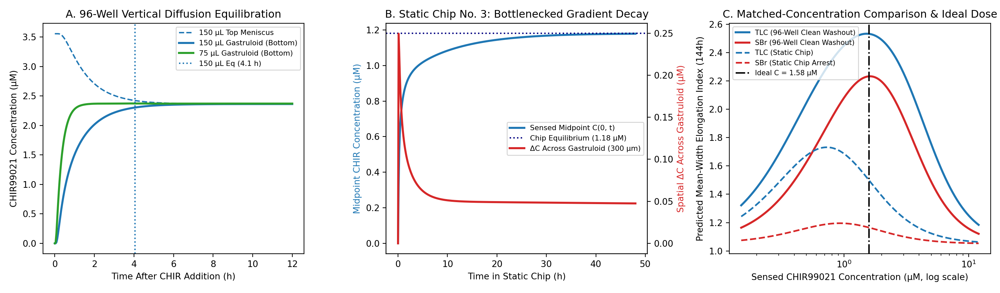
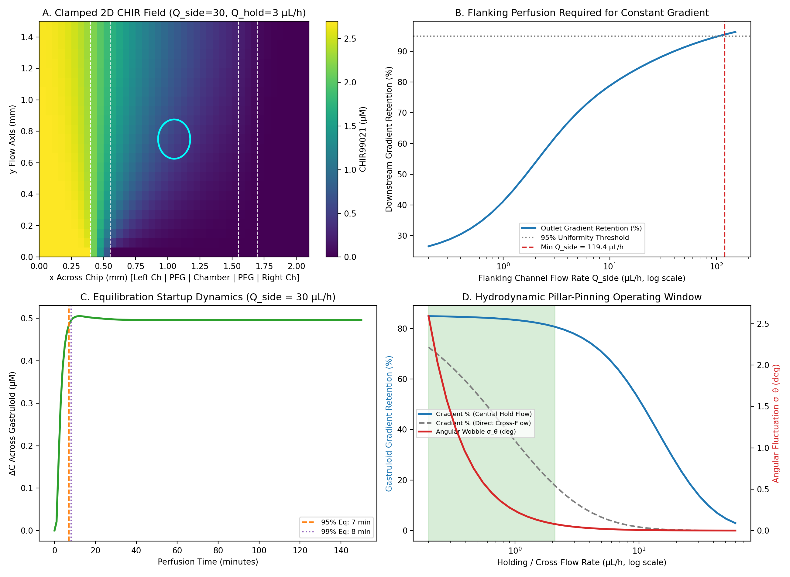

# Digital Twin of Microfluidic Gastruloid Symmetry Breaking & Morphogenesis

A 4-stage computational biology and continuum transport investigation extending experimental mESC gastruloid microfluidics research (EPFL LSCB). Built in pure scientific Python (`NumPy`, `SciPy`, `scikit-image`, `Matplotlib`) to run end-to-end in **Google Colab**.

## Key Questions & Findings

1. **Cell-Line Morphometry (`SBr` vs. `TLC`):** Classical Elongation Index ($L/D_{\max}$) underestimates `SBr` (`T/Bra::mCherry`) axial extension because `SBr` retains a bulbous anterior head alongside a narrow posterior tail, whereas `TLC` (`TCF/LEF::mCherry`) narrows globally with C-axis bending. Medial-axis Euclidean Distance Transform profiling ($D(s)$, Mean-Width EI, AP Tapering $\mathcal{T}_{AP}$, and Tail Fraction) resolves this paradox.
2. **CHIR99021 Transport & Ideal Dosing (96-Well vs. Static Chip):** Unmixed 96-well vertical gradients disappear in **~3.4 h** ($150\ \mu\text{L}$) or **~0.85 h** ($75\ \mu\text{L}$) at $1.0\times C_{\text{applied}}$. In static Chip No. 3, narrow supply channels bottleneck diffusion—erasing **>75% of the cross-gastruloid gradient within ~8–12 h**, equilibrating to **$0.50\times C_{\text{left}}$**, and delaying post-pulse washout (selectively arresting `SBr`). Joint biphasic modeling identifies **$C_{\text{ideal}} = 1.35\ \mu\text{M}$** ($C_{\text{left}} = 2.70\ \mu\text{M}$) as optimal.
3. **Biophysical Test of the Rotational Brownian Motion Hypothesis:** Stokes–Einstein–Debye thermal rotational diffusion of a $R = 125\ \mu\text{m}$ gastruloid ($D_{\text{rot}}^{\text{thermal}} = 4.55\times 10^{-4}\ \text{rad}^2/\text{h}$, $8.5^\circ$ RMS in 24 h) is **too slow** to disrupt gradient locking. Instead, zero-adhesion Pluronic-F127 coating permits active cellular migration and pipette-handling tumbling ($D_{\text{rot}}^{\text{eff}} \sim 0.8\ \text{rad}^2/\text{h}$), randomizing AP pole orientation.
4. **Microfluidic Perfusion & Hydrodynamic Pinning Design:** 2D advection–diffusion and Stokes/gap-suction mechanics show that flanking perfusion at **$Q_{\text{side}} \ge 25\text{–}30\ \mu\text{L}/\text{h}$** establishes a $>95\%$ constant gradient within **~36 min** ($95\%$ steady state), while a gentle central pillar-trap holding flow of **$Q_{\text{hold}} = 2\text{–}6\ \mu\text{L}/\text{h}$** prevents gastruloid rotation ($<5^\circ$ wobble) without diluting the CHIR gradient or exceeding stem-cell shear limits ($<2.5\ \text{mPa}$).

## Figures

