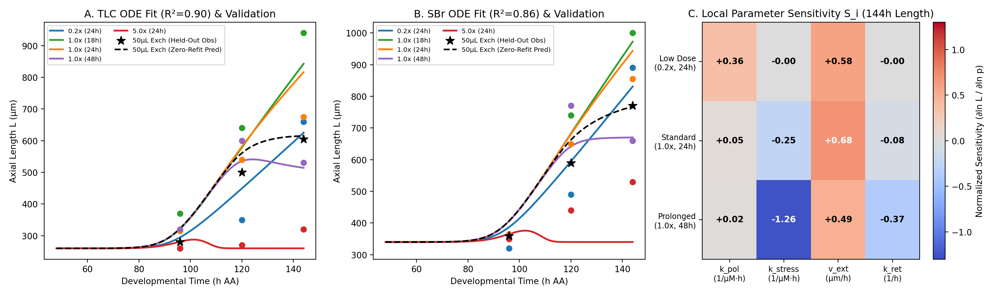

# Mechanistic Modelling of Microfluidic Gastruloid Symmetry Breaking & Morphogenesis

This computational biology project builds a mechanistic *in silico* framework directly extending experimental microfluidics research conducted in the Laboratory of Stem Cell Bioengineering (LSCB) at EPFL (*Study of Gastruloid Self-organization through Spatiotemporal Control of Wnt Activation Using Microfluidics*). It serves as a quantitative stepping stone toward data-constrained developmental digital twins by coupling automated bioimage morphometry, continuum transport PDEs, stochastic biophysics, and experimental parameter inference.

---

## Introduction & Experimental Background

Gastruloids are 3D embryonic organoids formed by aggregated mouse embryonic stem cells (mESCs) that recapitulate key morphological events of early mammalian development[^1]. During early embryogenesis, posterior Wnt signaling and anteriorly secreted Wnt antagonists coordinate cell polarity, symmetry breaking, and anteroposterior (AP) axis elongation. However, standard gastruloid protocols rely on a spatially homogeneous pulse of the exogenous Wnt agonist CHIR99021, which induces stochastic elongation axes while suppressing anterior neural tissues (fore-, mid-, and hindbrain)[^2].

**Figure 1.** *Axial elongation of mESC gastruloids in vitro (adapted from Beccari et al., Nature 2018[^1]).*

To guide deterministic AP axis formation via localized chemical gradients, three generations of PDMS microfluidic devices were designed and fabricated at EPFL, culminating in **Chip No. 3**—a 1,000 µm diameter, 490 µm high central trapping chamber flanked by 1% PEG hydrogel diffusion barriers, enlarged media reservoirs, and a non-adhesive 2% Pluronic-F127 coating into which gastruloids were transferred at 48 h after aggregation (AA). Across baseline 96-well perturbation assays and on-chip experiments, four empirical observations revealed tight coupling between morphogen transport, device physics, and tissue morphogenesis:

* **Narrow Biphasic CHIR99021 Window:** Screening concentrations from $0.2\times$ ($0.474\ \mu\text{M}$) to $5\times$ ($11.85\ \mu\text{M}$) relative to standard $1\times$ ($2.37\ \mu\text{M}$) across 75 µL and 150 µL well volumes, alongside 18–48 h pulse durations, showed that elevated doses ($3\times\text{--}5\times$) or prolonged 48 h exposure suppressed elongation, caused late shortening between 120 h and 144 h AA, or induced cell death.
* **Cell-Line Morphological Divergence (`TLC` vs. `SBr`):** Evaluated via ImageJ Maximum Inscribed Circle fitting, `SBr` (`T/Bra::mCherry`) and `TLC` (`TCF/LEF::mCherry`) aggregates displayed distinct axial geometries in 96-well plates (`SBr` reaching greater total axial length yet often lower classical Elongation Index), while under homogeneous 24 h on-chip CHIR99021 pulses ($0.5\times = 1.18\ \mu\text{M}$ and $0.7\times = 1.66\ \mu\text{M}$), `TLC` elongated by 144 h AA whereas `SBr` failed to elongate significantly.
* **Sensitivity to Incomplete Medium Washout:** Exchanging only 50 µL rather than the full 150 µL well volume after a 24 h CHIR99021 pulse impaired 144 h AA axial extension, indicating that residual post-pulse CHIR99021 retention inhibits late-stage elongation.

* **Loss of Directional Polarization in Static Microfluidic Gradients:** Plugging the Chip No. 3 outlet with 2.5% PEG hydrogel to isolate a CHIR99021-supplemented left channel from a fresh-medium right channel induced transient `SBr` elongation at 96 h AA that vanished by 120 h AA, hypothesized to result from free rotational Brownian motion inside the chamber.

---

## In Silico Modelling to Test Experimental Hypotheses

To disentangle diffusive bottlenecks, morphometric bias, rotational mechanics, and perfusion design from first principles, this repository implements a five-part computational pipeline:

### 1. Unbiased Cell-Line Morphometry (`SBr` vs. `TLC`)
Classical Elongation Index ($L/D_{\max}$) underestimates `SBr` axial extension because `SBr` retains a bulbous anterior head alongside a narrow posterior tail, whereas `TLC` narrows globally with C-axis bending. Benchmarked on noisy brightfield/fluorescence phantoms mimicking both phenotypes, Euclidean Distance Transform (EDT) and graph-geodesic skeletonization extract continuous diameter profiles $D(s)$, **Mean-Width EI** ($L/\overline{D}$), and **AP Tapering Asymmetry** ($\mathcal{T}_{AP}$), resolving this paradox.

**Figure 2.** *Automated medial-axis morphometry resolves cell-line elongation differences (`TLC` vs. `SBr`).* **(A–B)** Otsu segmentation, geodesic spines, and EDT inscribed circles on synthetic 144 h AA phantoms. **(C)** Continuous AP diameter profiles $D(s)$. **(D)** Multi-parametric morphological fingerprint ($n = 12$ per group).

### 2. CHIR99021 Transport & Equilibration (96-Well vs. Static Chip)
Unmixed 96-well vertical diffusion ($D = 1.80\ \text{mm}^2/\text{h}$ at 37 °C) equilibrates (<5% top–bottom difference) in **~3.4 h** (150 µL) or **~0.85 h** (75 µL) at $1.0\times C_{\text{applied}}$. In static Chip No. 3, mass-conserving 1D finite-volume simulations show that narrow supply arms bottleneck diffusion—erasing **>75% of the cross-gastruloid gradient within ~8–12 h**, equilibrating to **$0.50\times C_{\text{left}}$**, and delaying post-pulse washout (selectively arresting `SBr`). Joint dose–response analysis identifies **$C_{\text{ideal}} = 1.35\ \mu\text{M}$** ($C_{\text{left}} = 2.70\ \mu\text{M}$ in a symmetric gradient chip) as optimal.

**Figure 3.** *CHIR99021 equilibration kinetics and matched-concentration dose response.* **(A)** 96-well vertical diffusion. **(B)** Static Chip No. 3 midpoint equilibration and cross-organoid $\Delta C$ decay. **(C)** Matched-concentration comparison and optimal target dose.

### 3. Experimental ODE Calibration, Out-of-Sample Validation & Sensitivity Analysis
To anchor the kinetics in experimental measurements, a structurally identifiable 4-parameter ODE model ($k_{\text{pol}}, k_{\text{stress}}, v_{\text{ext}}, k_{\text{ret}}$) was fitted via constrained nonlinear least squares (`scipy.optimize.least_squares`) to 15 experimental timepoints per cell line across $0.2\times\text{--}5\times$ CHIR99021 and 18–48 h pulses ($R^2 = 0.90$ for `TLC`, $R^2 = 0.86$ for `SBr`). Tested **without refitting** on the held-out 50 µL partial medium-exchange experiment, the calibrated model accurately predicts 144 h AA elongation arrest (615 µm predicted vs. 605 µm observed in `TLC`; 767 µm vs. 770 µm in `SBr`). Local sensitivity analysis ($\partial \ln L_{144} / \partial \ln p_i$) demonstrates a regime shift from polarization-limited growth ($k_{\text{pol}}$) at $0.2\times$ CHIR99021 to over-saturation stress dominance ($k_{\text{stress}} = -1.26$) under 48 h exposure.

**Figure 4.** *Experimental ODE calibration, zero-refit validation, and parameter sensitivity.* **(A–B)** Least-squares fits to experimental `TLC` and `SBr` 96-well trajectories (96–144 h AA) plus zero-refit predictions for held-out 50 µL partial washout (black stars/dashed curve). **(C)** Local normalized sensitivity heatmap across dosing regimes.

### 4. Biophysical Test of the Rotational Brownian Motion Hypothesis
Evaluating Stokes–Einstein–Debye rotational diffusion for a $R = 125\ \mu\text{m}$ gastruloid at 37 °C yields $D_{\text{rot}}^{\text{thermal}} = 4.55\times 10^{-4}\ \text{rad}^2/\text{h}$ ($8.5^\circ$ RMS drift over 24 h)—four orders of magnitude **too slow** to disrupt Turing gradient locking. Instead, coupling a periodic Gierer–Meinhardt Wnt–antagonist PDE to Euler–Maruyama rotational SDEs shows that substrate-free active cell-migration and pipetting tumbling on non-adhesive 2% Pluronic-F127 ($D_{\text{rot}}^{\text{eff}} \sim 0.8\ \text{rad}^2/\text{h}$) randomizes AP pole alignment across replicates.

**Figure 5.** *Biophysical falsification of pure thermal Brownian motion versus active tumbling.* **(A)** Angular trajectories $\phi(t)$. **(B)** Perimeter endogenous Wnt kymograph under tumbling. **(C)** Ensemble gradient alignment index ($n = 18$ per regime).

### 5. Microfluidic Perfusion & Hydrodynamic Pillar-Pinning Design
Solving the 2D upwind advection–diffusion PDE and Stokes/gap-suction mechanics across Chip No. 3 shows that flanking perfusion at **$Q_{\text{side}} \ge 25\text{--}30\ \mu\text{L/h}$** clamps a $\ge 95\%$ constant gradient within **~36 min** (95% steady state), while a gentle central holding withdrawal of **$Q_{\text{hold}} = 2\text{--}6\ \mu\text{L/h}$** seats the gastruloid against 50 µm PDMS pillars ($<5^\circ$ wobble, >80% gradient retention, and <2.5 mPa wall shear stress).

**Figure 6.** *2D perfusion gradient clamping and hydrodynamic pillar-pinning operating window.* **(A)** Steady-state 2D CHIR99021 field ($Q_{\text{side}} = 30\ \mu\text{L/h}$, $Q_{\text{hold}} = 3\ \mu\text{L/h}$). **(B)** Flanking flow sweep. **(C)** Transient startup equilibration. **(D)** Central pillar-pinning window versus direct cross-flow washout.

---

## Numerical Methods Summary

| Module | Mathematical Formulation | Numerical Implementation (`SciPy` / `scikit-image`) |
| :--- | :--- | :--- |
| **1. Morphometry** | Otsu thresholding, Euclidean Distance Transform, medial-axis graph diameter | `filters.threshold_otsu`, `distance_transform_edt`, `csgraph.shortest_path` |
| **2. Static Transport** | 1D Fickian PDE & variable-area Finite Volume Method (harmonic face conductance) | Method of Lines + stiff `solve_ivp(method="BDF")` |
| **3. Data Inference** | 4-parameter nonlinear ODE system, Gauss–Newton covariance & local sensitivity | `optimize.least_squares` (Trust Region Reflective) + central finite differences |
| **4. Symmetry Breaking** | Periodic Gierer–Meinhardt Turing PDE coupled to rotational Brownian SDE | Periodic central differences (`BDF`) + Euler–Maruyama Monte Carlo ($n = 18$) |
| **5. Chip Perfusion** | 2D steady & transient upwind advection–diffusion PDE + Stokes/Poiseuille mechanics | Sparse direct LU (`sparse.linalg.spsolve`) + transient `BDF` |

---

## Model Scope, Assumptions & Development Note

* **Data & Parameter Provenance:** Module 3 is calibrated and validated directly against experimental 96-well `TLC` and `SBr` axial length time-series from EPFL LSCB ($n = 6$ per condition). Module 1 benchmarks the automated morphometry algorithm on synthetic microscopy phantoms parameterized to match observed `TLC`/`SBr` shapes. Modules 2, 4, and 5 combine physical constants ($D_{\text{CHIR}}$, $\eta_{37^\circ\text{C}}$, chip CAD dimensions, Stokes–Einstein–Debye $D_{\text{rot}}^{\text{thermal}}$) with representative reaction–diffusion and active-torque estimates.
* **Simplifying Assumptions:** Signalling symmetry breaking is modelled on a 1D non-deforming perimeter rather than a 3D growing viscoelastic tissue, and microfluidic transport is solved via depth-averaged 2D laminar advection–diffusion.
* **Development Note:** Built by Si-Ying Lai to bridge experimental organoid bioengineering with quantitative biophysical modelling. Code architecture and numerical solvers were prototyped with AI assistance (Google Gemini) and verified against physical conservation laws, analytical scaling limits, and experimental datasets.

---

## How Simulation Advances the Project

* **Shortens Cleanroom Iteration:** Evaluates channel resistance, gradient lifetime, and shear stress *in silico* before photolithography and PDMS casting, avoiding multi-generation redesigns like Chip No. 1–3.
* **Separates Physics from Biology:** Pinpoints post-pulse CHIR99021 retention behind on-chip `SBr` arrest and rules out passive thermal Brownian motion in favor of substrate-free active/pipetting rotation on 2% Pluronic-F127.
* **Automates Unbiased Morphometry:** Replaces manual ImageJ circle fitting with fast medial-axis $D(s)$ profiling, preventing false-negative readouts in bulbous-headed `SBr` aggregates.
* **Defines Exact Wet-Lab Setpoints:** Narrows pump testing to a concrete operating window ($C_{\text{left}} = 2.70\ \mu\text{M}$, $Q_{\text{side}} = 25\text{--}30\ \mu\text{L/h}$, 36 min equilibration, and $Q_{\text{hold}} = 2\text{--}6\ \mu\text{L/h}$ pillar pinning).

---

## Conclusions & Future Work

### Conclusions
1. **Unbiased Morphometry:** Continuous EDT width profiles $D(s)$, Mean-Width EI ($L/\overline{D}$), and AP Tapering ($\mathcal{T}_{AP}$) resolve the bias of classical $L/D_{\max}$ against bulbous-headed `SBr` gastruloids.
2. **Transport & Washout Bottlenecks:** Narrow static-chip supply arms lose >75% of the spatial CHIR99021 gradient within 8–12 h around a $0.50\,C_{\text{left}}$ midpoint and trap post-pulse CHIR99021; experimental ODE calibration ($R^2 = 0.86\text{--}0.90$) and zero-refit partial-washout validation confirm that cumulative Wnt over-saturation drives late axial shortening.
3. **True Rotational Mechanism:** Pure thermal Brownian motion is four orders of magnitude too slow ($8.5^\circ$ over 24 h) to disrupt symmetry breaking; active cellular and pipetting rotation on non-adhesive Pluronic-F127 causes directional washout.
4. **Deterministic Flow Protocol:** Pairing $Q_{\text{side}} = 25\text{--}30\ \mu\text{L/h}$ flanking perfusion with $Q_{\text{hold}} = 2\text{--}6\ \mu\text{L/h}$ central pillar pinning stabilizes both the CHIR99021 gradient (>80%) and organoid orientation ($<5^\circ$ drift, <2.5 mPa shear).

### Future Work
1. **3D Deformable Cell-Based Mechanics:** Couple posterior Wnt/Brachyury signaling to 3D cell adhesion and cortical tension (`SimuCell3D`-style) to mechanistically simulate `SBr` head-bulb retention versus `TLC` trunk narrowing.
2. **4D Live-Imaging Calibration:** Infer endogenous signaling kinetics and tissue surface tensions directly from 4D light-sheet/confocal time-lapse stacks of `TLC` and `SBr` reporters.
3. **Opposing Counter-Gradients:** Pair posterior CHIR99021 with an anterior Wnt antagonist (e.g., XAV939 or IWP2) to simultaneously induce anterior brain territories alongside posterior elongation.
4. **On-Chip Pump Validation:** Test the $Q_{\text{side}} = 30\ \mu\text{L/h}$ and $Q_{\text{hold}} = 3\ \mu\text{L/h}$ operating window experimentally using 500 Da fluorescent tracers and perfused gastruloids.

[^1]: Beccari, L., Moris, N., Girgin, M. et al. Multi-axial self-organization properties of mouse embryonic stem cells into gastruloids. *Nature* 562, 272–276 (2018).
[^2]: Girgin, M. U., Broguiere, N., Mattolini, L., & Lutolf, M. P. Gastruloids generated without exogenous Wnt activation develop anterior neural tissues. *Stem Cell Reports* 16(5), 1143–1155 (2021).
